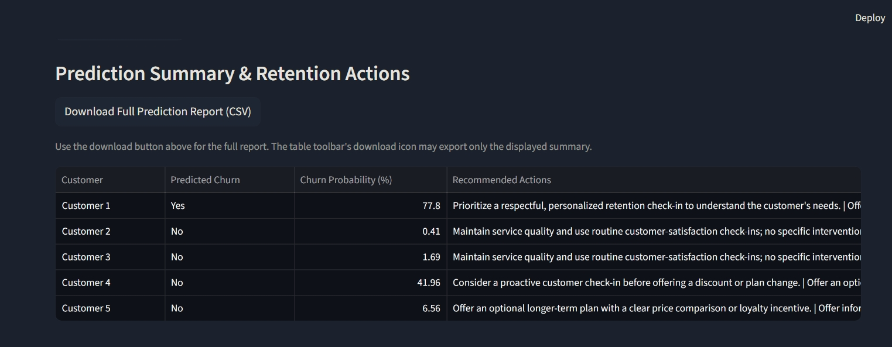
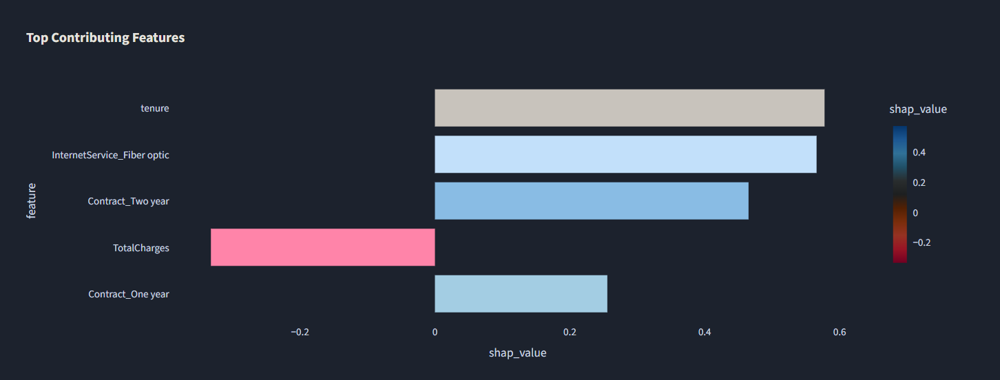

# ChurnXplain

**Explainable customer churn prediction with actionable retention suggestions.**

ChurnXplain is a machine-learning project that estimates customer churn risk from telecom account data. It uses **XGBoost** for classification and **SHAP** to help explain which input features contribute to an individual prediction. A Streamlit dashboard provides customer-level and CSV-based prediction workflows, while a Flask API serves predictions.

> **Project status:** Local development / portfolio project. Predictions and rule-based retention suggestions are decision-support aids, not guarantees or proven causal explanations.

## Highlights

- **Churn-risk prediction** using an XGBoost classifier.
- **Explainable AI** with SHAP feature contributions for individual customers.
- **Interactive dashboard** built with Streamlit and Plotly.
- **Two input workflows:** enter a customer's telecom details manually or upload a CSV using the model's encoded feature schema.
- **Input validation** for required columns, numeric values, binary flags, and basic service consistency.
- **Retention suggestions** generated by transparent rules based on customer attributes and predicted churn probability.
- **Prediction history** for reviewing previous runs in the local dashboard.
- **CSV report export** including predicted churn status, probability, suggested actions, and model input features.


## Dashboard Preview

### Churn Prediction & Retention Recommendations

The dashboard predicts customer churn probability and provides rule-based retention suggestions for each customer.



### Explainable AI with SHAP

SHAP feature contributions help explain which input features influence an individual model prediction.




## How it works

1. **Preprocess the data** — clean the telecom dataset and encode categorical variables.
2. **Train the model** — train and evaluate an XGBoost classifier.
3. **Explain predictions** — use SHAP to show feature contributions.
4. **Serve predictions** — a Flask API loads the saved model, scaler, and feature schema.
5. **Use the dashboard** — Streamlit sends manual or CSV customer data to the API and displays the results.
6. **Review possible actions** — simple rules suggest retention follow-ups based on the input profile and predicted risk.

## Architecture

```text
Telecom customer data
        |
        v
Preprocessing and feature encoding
        |
        v
XGBoost model + saved scaler + feature schema
        |
        v
Flask prediction API  <----  Streamlit dashboard
                                |
                                +-- Manual customer entry
                                +-- Validated CSV upload
                                +-- Churn probability
                                +-- SHAP feature contributions
                                +-- Rule-based retention suggestions
                                +-- Prediction history / CSV export
```

## Technology stack

- **Language:** Python
- **Machine learning:** XGBoost, scikit-learn
- **Explainability:** SHAP
- **API:** Flask, Flask-CORS
- **Dashboard and charts:** Streamlit, Plotly
- **Data handling:** pandas, NumPy
- **Model/artifact handling:** joblib, JSON

## Project structure

```text
ChurnXplain/
├── models/
│   ├── xgb_churn_model.pkl
│   ├── standard_scaler.pkl
│   └── feature_columns.json
├── notebooks/
├── 01_data_preprocessing.py
├── 02_model_training.py
├── 03_model_explain.py
├── 04_backend_api.py
├── 05_frontend_dashboard.py
├── churn_preprocessing.py
├── requirements.txt
├── sample_customers_corrected.csv
├── README.md
└── .gitignore
```

The exact files present in your local copy may differ. Only include artifacts and sample files that are safe and necessary to share publicly. Local account data, databases, prediction histories, credentials, and backup scripts should not be published.

## Getting started

### 1. Clone the repository

```bash
git clone https://github.com/RTiwari06/ChurnXplain.git
cd ChurnXplain
```

### 2. Create and activate a virtual environment

**Windows (PowerShell or Command Prompt):**

```bash
python -m venv .venv
.venv\Scripts\activate
```

**macOS / Linux:**

```bash
python3 -m venv .venv
source .venv/bin/activate
```

### 3. Install dependencies

```bash
python -m pip install --upgrade pip
pip install -r requirements.txt
```

Use the project's `requirements.txt` as the dependency source. If installation fails because of conflicting package versions, resolve and test the environment before changing dependency pins.

### 4. Confirm the model artifacts are present

The prediction API and dashboard expect the saved model artifacts and feature schema in the `models/` directory. The expected artifacts are:

- `xgb_churn_model.pkl`
- `standard_scaler.pkl`
- `feature_columns.json`

If these are not present in the repository, train the model using the project's preprocessing and training workflow before starting the API. Do not commit a newly generated model until you have verified that it matches the saved feature schema and preprocessing pipeline.

### 5. Start the Flask API

Open a terminal in the project root and run:

```bash
python 04_backend_api.py
```

The dashboard is configured to send prediction requests to:

```text
http://127.0.0.1:5000/predict
```

Keep this terminal running while using the dashboard. If the backend exposes a health endpoint in your current version, visit `http://127.0.0.1:5000/health` to check its status.

### 6. Start the Streamlit dashboard

Open a second terminal, activate the same virtual environment, and run:

```bash
streamlit run 05_frontend_dashboard.py
```

Streamlit will print the local URL to open in your browser.

## Using the dashboard

### Manual prediction

1. Sign in to the dashboard.
2. Open the prediction page.
3. Enter the customer's telecom account details.
4. Select **Predict Churn**.
5. Review the predicted churn probability, SHAP explanation, and suggested retention actions.

### CSV prediction

1. Prepare a CSV with the exact encoded feature columns listed in `models/feature_columns.json`.
2. Use numeric values for numeric features and `0` / `1` for binary encoded features.
3. Upload the CSV and review its preview.
4. Select the prediction action.
5. Review the predictions and use the dedicated full-report download control to export results.

**Important:** the CSV workflow expects model-ready encoded features, not the original raw telecom dataset. Do not add an index column, customer ID, target label, or extra columns unless the current schema explicitly includes them. Use the corrected sample CSV included with the project, if present, as a format example.

## Model evaluation

The latest training run recorded these metrics:

| Metric | Score |
|---|---:|
| Accuracy | 0.7775 |
| Churn precision | 0.5874 |
| Churn recall | 0.5481 |
| Churn F1-score | 0.5671 |
| ROC-AUC | 0.8198 |

These figures describe one training/evaluation run and are not a guarantee of performance on new data. Re-run evaluation after changing the dataset, preprocessing, model, or feature schema. For churn applications, review precision and recall alongside accuracy because missing likely-to-churn customers and incorrectly flagging customers have different costs.

## Understanding explanations and retention suggestions

SHAP values describe how features contribute to a model output relative to the explainer's reference. Their numerical scale depends on how the explainer is configured; they should not automatically be described as percentage-point changes in churn probability.

Retention suggestions are **rule-based recommendations**, not causal findings. For example, the dashboard may suggest reviewing contract options, onboarding, billing, technical support, or payment options based on customer attributes and risk thresholds. These suggestions should be reviewed by a person and adapted to real business policies before use.

## Data and privacy

- Use synthetic or appropriately anonymized customer records for demos.
- Do not commit real customer data, account credentials, `.env` files, local databases, or prediction history.
- Keep local user/account files out of version control.
- The dashboard's local sign-in feature should not be treated as production-grade authentication unless password hashing, secure session handling, and appropriate access controls have been implemented.
- Review all sample files and model artifacts for sensitive information before making the repository public.

## Limitations

- Predictions depend on the training data and the consistency of incoming features.
- The CSV upload expects the model's encoded feature schema.
- Retention suggestions are simple rules and are not evidence that a specific action will prevent churn.
- Localhost API configuration is intended for local use; deployment requires an appropriate API URL, secure configuration, and access controls.
- Model metrics may change when the data split, data, preprocessing, or model configuration changes.

## Future improvements

- Add automated tests for preprocessing, schema validation, API responses, and CSV export.
- Add a reproducible evaluation report and compare the model with a simple baseline.
- Improve authentication and secrets management before any public deployment.
- Add configuration for the API URL instead of hard-coding localhost.
- Add a deployment guide and screenshots after verifying the complete application.
- Track model versions and data assumptions.

## Author

**Riya Tiwari**
GitHub: [@RTiwari06](https://github.com/RTiwari06)

---

If you find an issue or have a suggestion, feel free to open a GitHub issue.
